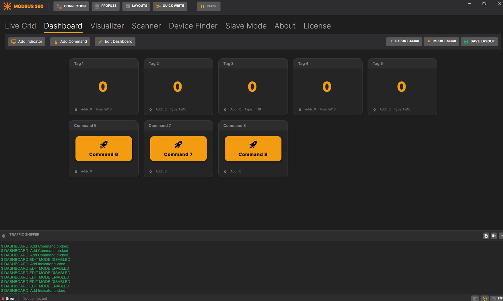

# MODBUS 360 — Industrial Modbus Client



[](https://github.com/lunasoft-llc/modbus-360/releases)
[](https://dotnet.microsoft.com/download)
[](https://github.com/lunasoft-llc/modbus-360/releases)

MODBUS 360 is a cross-platform tool for monitoring, testing, visualizing, and controlling Modbus devices.

## Key features

### Connections and sessions

- Modbus TCP/IP, Modbus RTU (serial), and Modbus RTU over TCP.
- Parallel, isolated device sessions through **New Session**.
- Editable IP history with recently used addresses shown first.
- Automatic restoration of the last successful connection:
  - transport, IP address, and port;
  - COM port and baud rate;
  - data bits, parity, stop bits, and flow control;
  - Unit ID, connection timeout, and poll interval.
- Automatic system COM-port discovery with manual entry support.
- Configurable TCP connection timeout and polling interval.

> Modbus ASCII and Modbus UDP are not currently supported.

### Import a device register map from PDF

1. In the Master toolbar, click **Profiles** next to **Connection**, then click **Import register map** at the bottom left of the dialog.
2. Enter an OpenAI API key in the dialog or set `OPENAI_API_KEY` before launching Modbus360. The selected PDF (up to 20 MB) is sent to the OpenAI Responses API. The default model is `gpt-4.1-mini`; set `MODBUS360_OPENAI_MODEL` to use another model that supports PDF input and JSON output.
3. Compare the editable JSON with the manual, including the source page, original address, zero-based PDU offset, register table, type, scale, and word order. Resolve any warnings before saving. Large manuals can be split to the relevant register pages.
4. Select **Save Master** to add the map to Device Profiles. Load it while disconnected and set the actual TCP or serial connection details before reading the device. Select **Save and open Slave** to save a `.m360slave` file and open it in the simulator. The simulator starts when you press Start.

You can also paste an existing JSON map into the preview with no API call. Example:

```json
{
  "name": "Example meter",
  "unitId": 1,
  "registers": [
    {
      "name": "Voltage",
      "address": 0,
      "type": "HoldingRegister",
      "dataType": "Uint16",
      "multiplier": 0.1,
      "offset": 0,
      "unit": "V",
      "source": "Page 12, 40001",
      "initialWords": [2300]
    }
  ]
}
```

Addresses are zero-based. Supported tables are `Coil`, `DiscreteInput`, `HoldingRegister`, and `InputRegister`. Bit rows use `Boolean`. Word rows support `Int16`, `Uint16`, `Int32`, `Uint32`, `Float`, `Boolean`, and `Hex`. For two-word rows, specify the wire byte order as `ABCD`, `BADC`, `CDAB`, or `DCBA`. Import translates this to the existing Master profile's conversion setting. Supply initial words in wire order. Omitted initial words simulate zero. Each Master row can span two Slave words. Overlaps and unresolved fields required for decoding must be corrected before saving.

### Register polling

- Smart contiguous block polling: adjacent registers are read in a single Modbus request.
- Correct word counts for 16-bit, 32-bit, float, and double values.
- Holding Registers, Input Registers, Coils, and Discrete Inputs.
- On first connection to a new IP, addresses `0–9` are created automatically.
- Register configuration is stored per IP and restored on the next connection.
- Editable address, name, register type, data type, multiplier, offset, and unit.
- Single and multiple register/coil writes using FC05, FC06, FC15, and FC16.
- FC23 Read/Write Multiple Registers support in the service layer.
- Correct Modbus Big Endian handling for RTU and RTU-over-TCP.

### Data representation

- Int16, UInt16, Int32, UInt32, Float, Double, Boolean, and Hex.
- Scaling formula: `Scaled Value = (Raw Value × Multiplier) + Offset`.
- Configurable byte/word order: ABCD, CDAB, BADC, and DCBA.
- Raw hexadecimal and converted values displayed together.

### Test and diagnostics

- Raw Modbus TCP **Test Center** for complete MBAP + PDU hexadecimal frames.
- MBAP length and hexadecimal input validation.
- TX/RX response display with configurable timeout.
- Traffic sniffer and CSV logging/export.
- Address Scanner and Unit ID Device Finder.
- Quick Write commands.
- Real-time charts and connection performance information.

### Dashboard and server mode

- Custom dashboards with live values and write-action buttons.
- Drag, resize, grid snap, named layouts, and `.m360` import/export.
- Modbus TCP and RTU slave/server modes with Coils, Discrete Inputs, Input Registers, and Holding Registers.
- Live client count, write synchronization, and server traffic log.
- Click a **Value** cell to enter a decimal register word from 0 to 65535. Press Enter or leave the field to apply it. Select **Manual** to keep your test value.
- A Slave profile can set `float32Simulations` entries with the word table (`2` for Input Registers or `3` for Holding Registers), zero-based first word `address`, `mode: "Random"`, `minimum`, `maximum`, `intervalMs`, and `decimalPlaces`. Both words must exist and have `simulationMode: 0`. The simulator updates both words together in most-significant-word-first order.
- A profile can also configure `threePhaseSimulation` with three voltage and current register addresses, ranges and an update interval. It writes the phase values, power factor, frequency, and total active power as Float32, and accumulates imported energy in an Int64 Wh counter. Addresses are zero-based and register words are most-significant first.
- **Save profile** stores the transport settings, Unit ID, and all four tables' current values in a reusable `.m360slave` file. Stop the server before opening a profile.
- Double-click a register's **Name** to label it. Select a row to set its simulation to **Manual**, **Count up**, **Alternate**, or **Random**. Automatic modes run while the server is active, using the row's interval and range. Bit tables use 0 and 1. Profiles retain names and simulation settings.
- Switch between register tables from the table header. Word tables show decimal and hex values, and bit tables use a state checkbox. The simulation editor shows the selected register's address and name.
- **Paste registers** imports two Excel columns, address and value, into the selected table. Addresses and values accept decimal or `0x` hexadecimal. The server supports imported addresses from 0 to 65534. Bit tables accept 0 or 1. Existing addresses are updated and new addresses are added.
- The slave log shows the Unit ID, function code, address, and quantity for supported requests, plus changes made by master writes.

## Installation

### Windows

Download the latest installer or portable ZIP from [GitHub Releases](https://github.com/lunasoft-llc/modbus-360/releases).

The installer adds **Modbus360 Master** and **Modbus360 Slave** to both the Start menu and the desktop. For the portable build, run `Modbus360.exe` to open Master or `Modbus360.exe --slave` to open Slave Server directly.

### Linux

Download the self-contained Linux archive from GitHub Releases. Preserve executable permissions when extracting.

### macOS

Apple Silicon (M1/M2/M3/M4) Macs are supported. Intel Macs are not.

- `Modbus360-macOS-Apple-Silicon-*.dmg`
- `Modbus360-macOS-Apple-Silicon-*.zip`

The ZIP files contain the complete `Modbus360.app` bundle. No separate .NET runtime is required.

To install from a DMG, drag `Modbus360.app` to Applications. Current packages are ad-hoc signed but not Apple-notarized. If Gatekeeper blocks the first launch:

```bash
xattr -cr /Applications/Modbus360.app
```

Then Control-click the app and choose **Open**.

Maintainers can package both architectures on macOS:

```bash
chmod +x ./build-osx.sh
./build-osx.sh --version 1.2.13 --output publish/osx
```

The **Build macOS App and DMG** GitHub Actions workflow generates the same DMG, ZIP, and SHA-256 artifacts. When `distribute.ps1` runs on Windows, it waits for the tag-triggered macOS workflow, downloads those artifacts, and includes them in the public distribution.

## Build

```bash
dotnet restore MODBUS360.sln
dotnet build MODBUS360.sln -c Release
dotnet test MODBUS360.sln -c Release
```

Platform packaging scripts:

- Windows: `build-win.ps1`
- Linux: `build-linux.ps1`
- macOS: `build-osx.sh`

## Technology

- .NET 9
- Avalonia UI 11.3
- CommunityToolkit.Mvvm
- FluentModbus 5.3
- LiveChartsCore 2

## Support

Developed by [LUNASOFT INDUSTRIAL SYSTEMS](https://www.lunasoft.az), Baku, Azerbaijan.

Email: [support@lunasoft.az](mailto:support@lunasoft.az)

© 2024–2026 LUNASOFT INDUSTRIAL SYSTEMS. All rights reserved.
